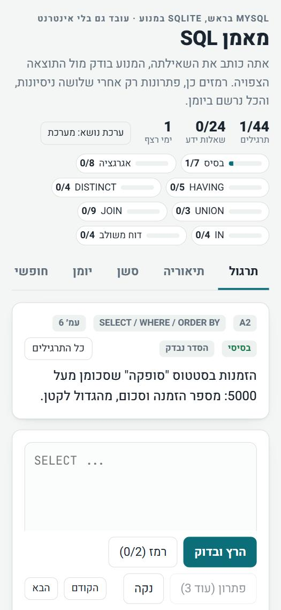

# מאמן SQL

**[לפתיחה: shovalnaor.github.io/sql-trainer](https://shovalnaor.github.io/sql-trainer/)**

מאמן SQL אינטראקטיבי בעברית, שרץ כולו בדפדפן. כותבים שאילתה, מנוע SQL אמיתי מריץ אותה ומשווה לתוצאה הצפויה. אין שרת, אין הרשמה, עובד גם בלי אינטרנט אחרי הפתיחה הראשונה.

נבנה כהכנה למבחן SQL (MySQL) של קורס מסדי נתונים, ולראיונות עבודה לתפקידי אנליסט.

## מה יש בפנים

- **מסלול מודרך.** חמישה עשר שלבים: שנים עשר בסדר ההרצאות, מאלגברה רלציונית ועד נרמול, ואחריהם שלושה שלבים ברמת ראיון. כל שלב נסגר אחרי קריאת הכרטיס, 3/3 בשאלות הידע וכל התרגילים. כפתור "המשך מאיפה שעצרת" פותח את הפריט הבא בדיוק. שום דבר לא נעול.
- **100 תרגילים** בשנים עשר נושאים ובמעבדה: SELECT/WHERE, אגרגציה ו-GROUP BY, HAVING, DISTINCT, UNION, JOIN/LEFT JOIN/NULL, IN, דוחות משולבים, קבוצות וצירופים (INTERSECT, EXCEPT, RIGHT ו-FULL JOIN, USING, NATURAL JOIN, SOME ו-ALL), תת-שאילתות, CTE, EXISTS ופונקציות חלון.
- **שני נושאים שאינם בחומר הקורס ולא בשום קורס:** *מקצוע האנליסט* (פרופיל נתונים, בקרת שלמות קשר, זיהוי כפילויות, מלכודת כפל השורות ב-JOIN, חלוקה בטוחה עם NULLIF, ציר זמן מלא) ו*שאלות ראיון* (הערך השני, דירוג בלי פונקציות חלון, self-join, חודשים עולים עם LAG, הראשון בכל קבוצה עם תיקו, חציון, טבלה צולבת, חילוק, קוהורטות, שיעור המרה, ממוצע נע עם מסגרת חלון, ניתוח פארטו, נטישה, ודה-דופליקציה).
- **בדיקה לפי תוצאה, לא לפי טקסט.** כל ניסוח נכון מתקבל. כשהתוצאה לא תואמת, המשוב מכוון: מספר שורות, שורות חסרות או מיותרות, סדר, עמודות.
- **רמזים מדורגים.** הפתרון נעול עד שלושה ניסיונות, ופתיחתו נרשמת ביומן.
- **בודק סטטי ל-MySQL.** המנוע הוא SQLite, שסלחן יותר. המאמן מזהיר על GROUP BY חלקי (ONLY_FULL_GROUP_BY), השוואה ל-NULL עם `=`, אגרגציה בתוך WHERE, וטבלה נגזרת בלי כינוי.
- **מעבדה.** לשונית נפרדת שבה מותר לשנות את המסד: INSERT, UPDATE, DELETE, CREATE TABLE עם מפתחות ואילוצים, ALTER, DROP, תצוגות ואינדקסים. כל הרצה מתחילה ממסד נקי, והבדיקה מריצה שאילתת ביקורת על המסד שנוצר, כך שכל ניסוח תקין מתקבל.
- **תיאוריה עם דוגמאות חיות.** שישה עשר כרטיסים: תחביר, כללים, דוגמאות שרצות על המנוע בלחיצה, ושלוש שאלות ידע עם הסבר לכל כרטיס.
- **סדר ביצוע.** כפתור שמפרק את השאילתה שלך לשלבים לפי סדר הביצוע הלוגי (FROM, JOIN, WHERE, GROUP BY, HAVING, חלון, SELECT, ORDER BY, LIMIT) עם הסבר לכל שלב.
- **בלוקי זמן.** טיימר לבלוק לימוד ארוך (תיאוריה, שחזור מהזיכרון, תרגול, רישום), בלוק תרגול בלבד, ושליפה יומית של 10 דקות שבוחרת תרגיל מהנושא החלש ביותר.
- **מצב מבחן.** 10 תרגילים אקראיים ב-30 דקות, בלי רמזים ובלי פתרונות. הציון נשמר ביומן.
- **חזרה שקטה.** תרגיל שנפתר חוזר לבחירה של השליפה היומית אחרי 3, 7, 21 ו-60 ימים. בלי מונים, בלי תזכורות.
- **מבנה הטבלאות בלשונית התרגול.** פאנל מתקפל עם ארבע הטבלאות, הטיפוסים, המפתחות והקשרים ל-JOIN, בלי לעזוב את התרגיל. לחיצה על שם עמודה מכניסה אותו לעורך.
- **עורך.** הדגשת תחביר בלי ספרייה, ושורת לחצנים של מילות מפתח, טבלאות ועמודות כדי לא להקליד SQL על מקלדת טלפון.
- **יומן טעויות.** כל ניסיון שגוי נשמר עם השאילתה, סטטיסטיקה לפי נושא, ימי רצף, ייצוא כ-CSV, וגיבוי JSON להורדה ולייבוא ממזג.
- **סנכרון אופציונלי** בין מכשירים דרך Firebase, עם מיזוג שלא דורס התקדמות.
- **גרסת MySQL** של אותם נתונים, לתרגול מקביל ב-Workbench.
- **אייפון.** מותאם למסך צר, ניתן להוספה למסך הבית כאפליקציה, ועובד בלי אינטרנט.

## הנתונים

ארבע טבלאות בדויות של מערך ציוד: `suppliers`, `products`, `orders`, `returns`. יש בהן מלכודות מכוונות: ספק בלי הזמנות, מוצר שמעולם לא הוזמן, הזמנות בלי סכום, דירוג חסר, והזמנה אחת שהוחזרה פעמיים. כל שם וכל מספר בדויים.

## איך זה בנוי

- `index.html`: כל האפליקציה בקובץ אחד (נתונים, תרגילים, תיאוריה, ממשק).
- `sql-asm.js`: [sql.js](https://github.com/sql-js/sql.js), SQLite שקומפל ל-JavaScript. מצורף כדי שהאתר יעבוד בלי תלות ברשת.
- `sw.js` ו-`manifest.webmanifest`: עבודה לא מקוונת והתקנה למסך הבית.
- `sync.js`, `sync-config.js`, `database.rules.json`: סנכרון אופציונלי בין מכשירים דרך Firebase Realtime Database.
- `mysql/`: אותה סכמה ואותם נתונים כסקריפט MySQL 8, כולל מסד המעבדה, לתרגול ב-Workbench.
- `tests/verify.js`: מריץ כל שאילתת ייחוס, כל דוגמה חיה וכל שאלת ידע מול המנוע, ובודק את הבודק הסטטי על שאילתות ידועות. רץ ב-GitHub Actions בכל push.

ההתקדמות נשמרת ב-localStorage של הדפדפן בלבד. כפתור הגיבוי ביומן מעתיק את כל המצב כ-JSON.

## סנכרון בין מכשירים (אופציונלי)

כברירת מחדל ההתקדמות נשמרת ב-`localStorage` של הדפדפן: מהר, פרטי, עובד לא מקוון, ולא עובר בין מכשירים. יש שתי דרכים להעביר אותה.

**ידנית, בלי כלום:** ביומן יש "הורד גיבוי" ו"ייבוא גיבוי". הייבוא **ממזג** ולא דורס, כך שאפשר לייבא לכל מכשיר בלי לאבד מה שכבר יש בו.

**אוטומטית, עם Firebase Realtime Database:** מלא את `sync-config.js` והאתר יסנכרן את הכל מול צומת אחד לכל משתמש ב-RTDB. ההוראות המלאות נמצאות בתוך הקובץ. בתמצית:

1. פרויקט ב-Firebase Console: חדש, **או פרויקט קיים שלך**. המאמן כותב רק לאוסף בשם `trainerState`, ולכן אפשר לשתף פרויקט עם אפליקציה אחרת בלי התנגשות. אם נגמרה המכסה, זו הדרך: מחיקת פרויקט נספרת במכסה עוד שלושים יום ולא תעזור מיד.
2. Realtime Database, במצב Locked.
3. Authentication, להפעיל Google, ולהוסיף את דומיין ה-Pages ל-Authorized domains.
4. להעתיק את ה-config מהגדרות הפרויקט לתוך `sync-config.js` (כולל השדה `databaseURL`).
5. ללשונית Rules של ה-Realtime Database: מדביקים את תוכן `database.rules.json` ומפרסמים.

הערכים ב-`sync-config.js` הם מזהים ולא סודות: גוגל מתעדת את מפתח ה-API של הלקוח כבטוח להטמעה בקוד צד-לקוח. מה שמגן על הנתונים הוא כללי האבטחה, שמתירים לכל משתמש לגעת רק במסמך שלו.

**המיזוג לא מוחק.** תרגיל שנפתר באחד הצדדים נשאר פתור, היומנים מתאחדים, ושאלה שנענתה נכון נשארת נכונה. התוצאה זהה בייט-בייט לא משנה איזה מכשיר סונכרן ראשון, מה שמונע לולאת כתיבות בין שני מכשירים. יש לכך בדיקות ב-`tests/verify.js`.

## תרגול ב-MySQL Workbench

המנוע באתר הוא SQLite, והוא סלחן יותר מ-MySQL. בתיקיית `mysql/` יש את אותה סכמה ואותם נתונים בדיוק:

- `schema.sql`: יוצר את מסד הנתונים `sql_trainer`, ארבע הטבלאות, 61 השורות והמפתחות הזרים. מפעיל גם את `ONLY_FULL_GROUP_BY`.
- `exercises.sql`: כל שאלות התרגול כהערות, בלי פתרונות, לפי סדר הנושאים.
- `lab.sql`: מסד המעבדה ושאלות ה-DDL וה-DML.
- `build.js`: מייצר את שניהם מחדש מתוך `index.html`, כדי ששתי הגרסאות לא יתפצלו.

ב-Workbench: File, Open SQL Script, להריץ את `schema.sql`, ואז לעבוד על `exercises.sql`. שימו לב ש-`condition` ו-`status` הן מילים שמורות ב-MySQL ודורשות גרשיים אחוריים, הבדל שהמנוע בדפדפן לא יתפוס.

## הרצה מקומית

פותחים את `index.html` בדפדפן. זהו. (עבודה לא מקוונת והתקנה דורשות שרת, למשל `python -m http.server`.)

## רישיון

MIT. ראה `LICENSE`. רישיון sql.js ב-`LICENSE-sql.js.txt`.

נבנה בעזרת Claude Code.

---

## English

Hebrew-language interactive SQL trainer that runs entirely in the browser: a real SQLite engine (sql.js) executes your query and compares the result set to the expected one. 100 exercises across twelve topics plus a write-mode lab for DDL and DML (set operations, outer joins, subqueries, CTEs, EXISTS, window functions, keys and constraints, views, indexes, plus two topics no course covers: analyst data-quality craft (profiling, referential checks, join fan-out, NULL-safe math, date spines) and the classic data-interview archetypes such as second highest, top-per-group with ties, division, cohorts, Pareto, median and deduplication), graded hints with the reference solution locked until three attempts, a static checker that flags queries SQLite accepts but MySQL rejects (partial GROUP BY, `= NULL`, aggregates in WHERE), theory cards with runnable examples and knowledge checks, study-block timers, and an error journal with CSV export. Optional cross-device sync via Firebase with a non-destructive merge, plus a MySQL 8 script of the same dataset for Workbench practice. Installable on iOS and works offline. Fictitious dataset, no backend, no tracking.
